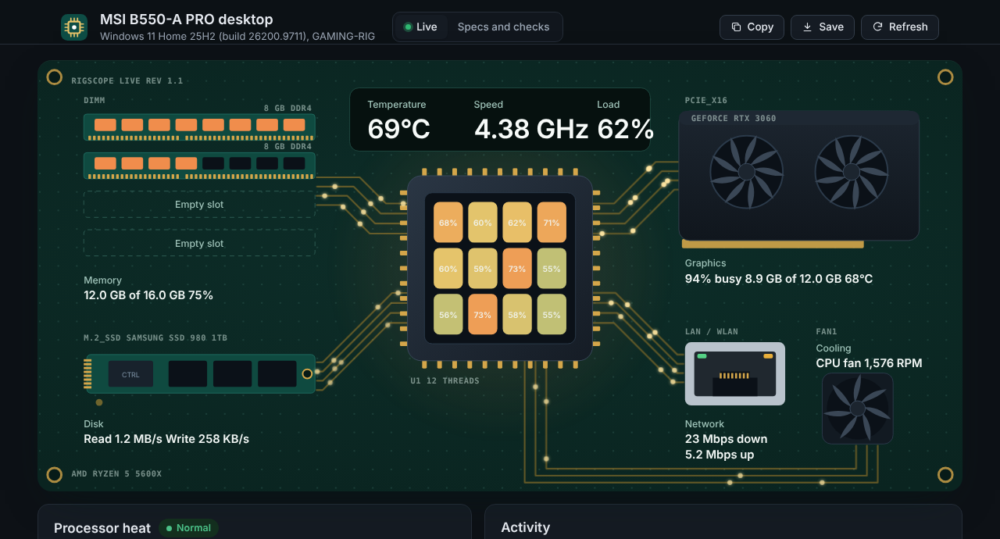
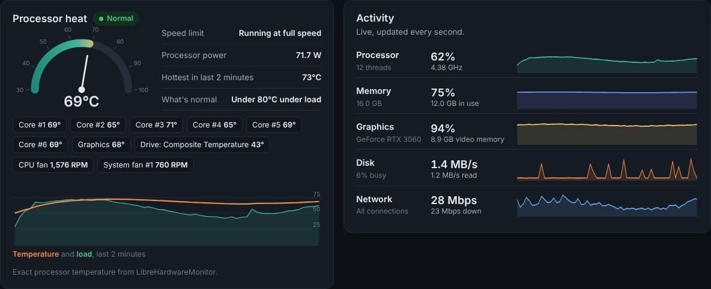
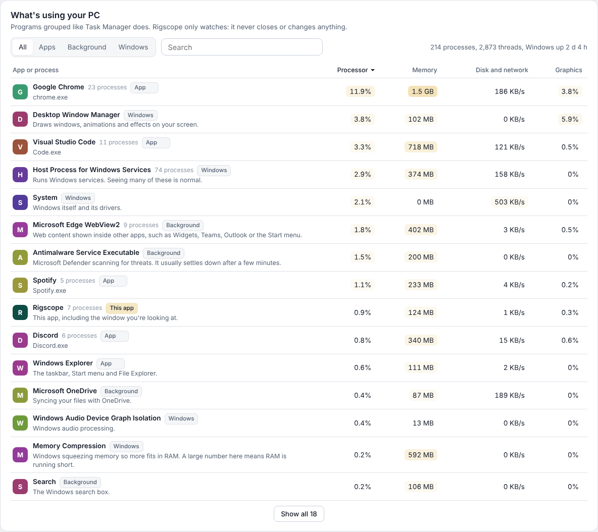
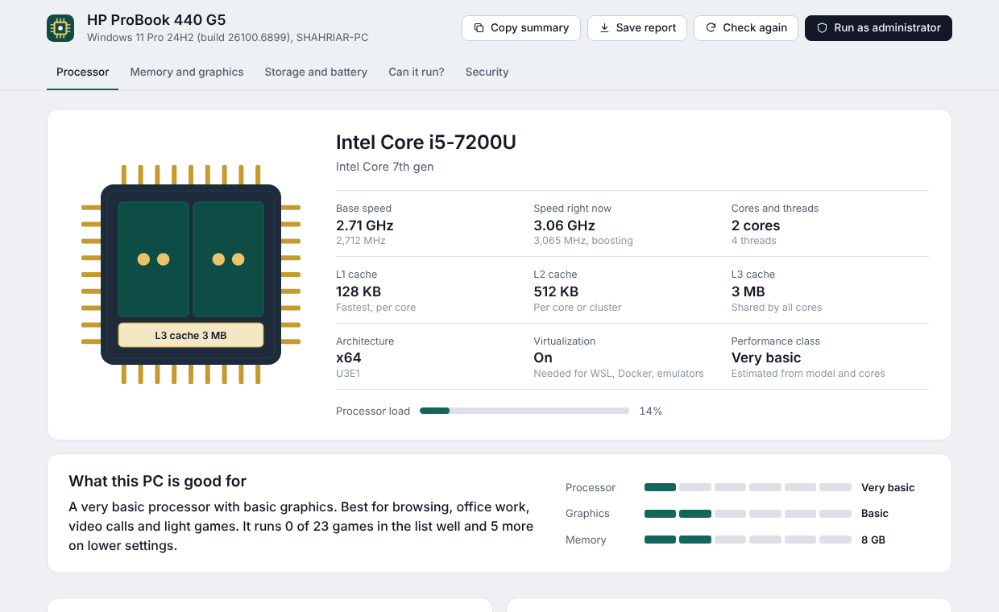
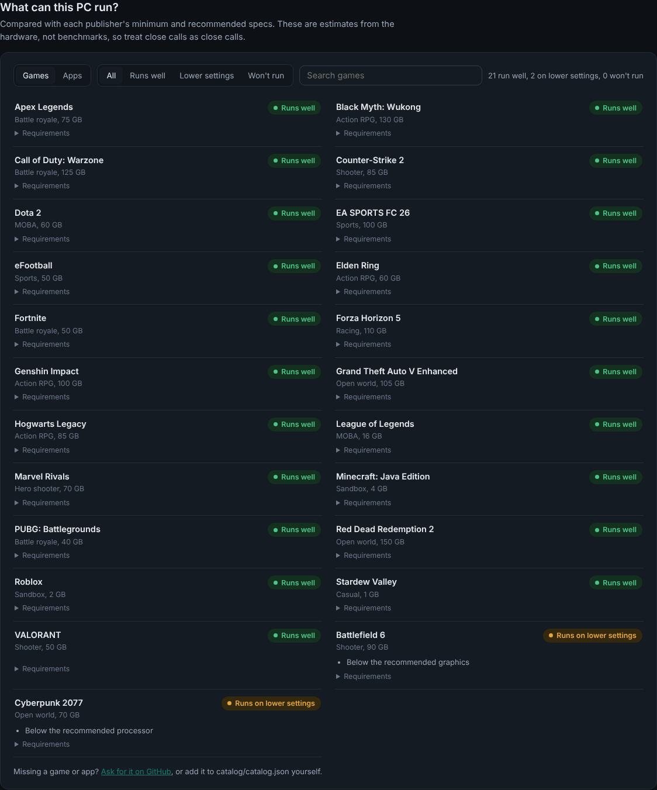
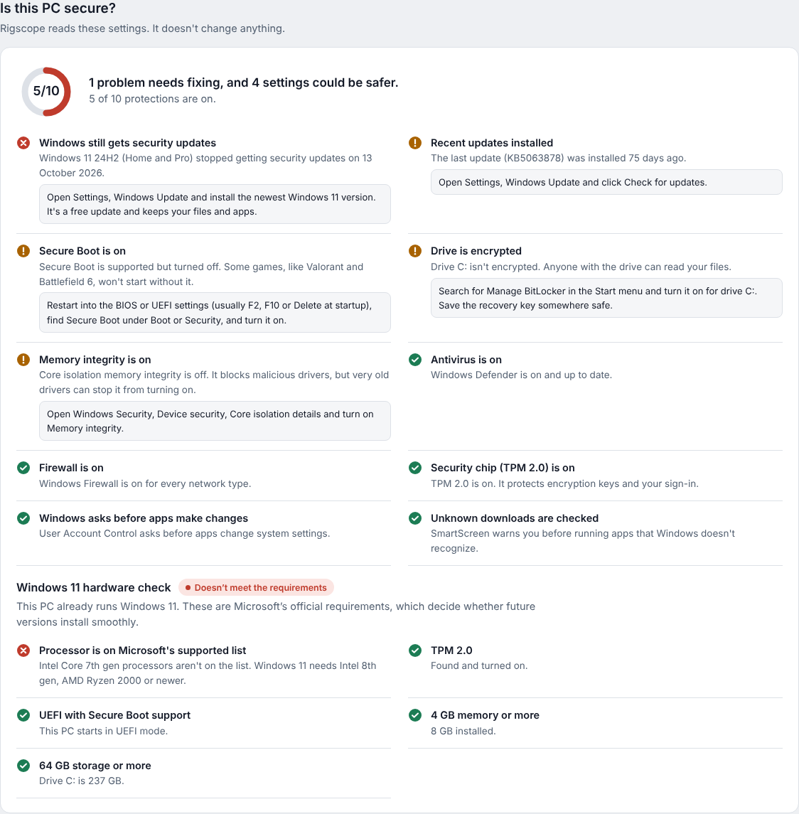

<p align="center"></p>

<h1 align="center">Rigscope</h1>

<p align="center">A live control panel for your Windows PC: what's inside it, how hot it runs, what's using it, what it can run, and whether it's secure.<br>One small app. Nothing to install. Nothing sent anywhere.</p>

<p align="center">
  <a href="../../releases/latest"><b>Download Rigscope.exe</b></a> ·
  <a href="#is-it-safe-to-run">Is it safe?</a> ·
  <a href="#how-can-it-run-works">How "Can it run?" works</a> ·
  <a href="CONTRIBUTING.md">Contribute</a>
</p>

<p align="center"><a href="../../actions/workflows/ci.yml"></a></p>



## Live control panel

Rigscope opens on a live, animated circuit board of your actual PC, updated every second:

- **Processor:** each thread is a tile that glows from teal to gold to red as it gets busier. The plate above it shows the temperature, the real clock speed (including boost) and the overall load. A heat glow spreads around the chip as it warms up.
- **Data moving through the PC:** pulses of light run along the gold traces to memory, graphics, storage and network. They speed up as each one gets busier: disk reads flow toward the processor and writes flow away, and downloads and uploads do the same on the network traces.
- **Memory:** the chips on each stick light up as memory fills. Empty slots show as outlines.
- **Graphics:** a dedicated card's fans spin with its load (or its real fan speed on NVIDIA cards), with video memory and temperature.
- **Battery or cooling:** laptops show charge and how many watts are going in or out. Desktops show the CPU fan spinning at its real speed when a sensor app is running.

Below the board:

- **Processor heat:** a temperature gauge, whether the processor is being slowed down to stay cool, power use, per-core temperatures and fan speeds (when available), and a two-minute history of temperature and load.
- **Activity:** live graphs of processor, memory, graphics, disk and network use.
- **What's using your PC:** every running program, grouped the way Task Manager groups them, with its processor, memory, disk and network, and graphics use. Familiar Windows processes come with a plain-English note, such as what *Antimalware Service Executable* or *Memory Compression* is doing. Rigscope only watches: it never closes or changes anything.

<table><tr>
<td></td>
<td></td>
</tr></table>

### About processor temperature

Windows doesn't give apps the exact core temperature. Reading it directly needs a kernel driver, and the common one (WinRing0) is now flagged by antivirus software, so Rigscope doesn't ship one. Instead it uses, in order:

1. **LibreHardwareMonitor or OpenHardwareMonitor**, if one of them is running. You get exact package and per-core temperatures, fan speeds and processor power. Rigscope picks this up automatically, even if you start the sensor app after Rigscope.
2. **Windows' thermal sensor** (the ACPI thermal zone), which most laptops have. It sits near the processor and can read a few degrees off.
3. Nothing, with an explanation, on PCs that expose neither.

Graphics temperature, fan speed and power come from NVIDIA's own `nvidia-smi` tool, which is installed with the NVIDIA driver.

## Specs and checks




**Processor:** the name, base speed in GHz and MHz, the speed it's running at right now (including boost), cores and threads, L1, L2 and L3 cache, architecture and whether virtualization is on. The chip drawing shows each core, with a dot per thread.

**Memory:** how much is installed, the type (DDR4, DDR5 and so on), the speed, which slots are used, and live usage. If there's an empty slot, it tells you what stick to add.

**Graphics:** each graphics chip with its real video memory (Windows' usual tools cap this at 4 GB), driver version and date, and screen resolution and refresh rate.

**Storage:** every SSD and hard drive with its health. Run as administrator to also see SSD life left, temperature, power-on time and error counts.

**Battery:** health as a percentage of the original capacity, how long a full charge lasts now compared with when it was new, and charge cycles.

**What can this PC run?** 23 popular games and 17 apps (Office, Photoshop, Premiere, DaVinci Resolve, Blender, Android Studio, Docker, local AI and more), each rated *Runs well*, *Runs on lower settings*, *Below minimum* or *Won't start*, with the reason.

**Security:** antivirus, firewall, whether your Windows version still gets security updates, recent updates, Secure Boot, TPM 2.0, drive encryption, User Account Control, memory integrity and SmartScreen. Each problem comes with steps to fix it. It also checks the Windows 11 hardware requirements.

**Reports:** *Copy summary* puts a plain-text summary on your clipboard. *Save report* saves it together with every detail as a text file, handy when asking for help or filing a bug.

<table><tr>
<td></td>
<td></td>
</tr></table>

## Download and run

1. Download **Rigscope.exe** from the [latest release](../../releases/latest).
2. Double-click it. It opens in its own window and closes completely when you close the window.

Works on Windows 10 and 11 (64-bit). It uses Microsoft Edge, which comes with Windows, to draw its window. Chrome or Brave are used if Edge was removed.

The first time you run it, Windows SmartScreen may say *Windows protected your PC*, because the download isn't code-signed (signing certificates cost money every year). Click **More info**, then **Run anyway**. You can check the file against the checksum in the release, or [build it yourself](#build-from-source).

For SSD wear, drive temperature and full TPM details, click **Run as administrator** in the app.

### Command line

```
Rigscope.exe --json > report.json   # print the full report as JSON and exit
Rigscope.exe --live > live.json     # print one live sample (load, temperatures, running apps)
Rigscope.exe --version
```

## Is it safe to run?

Rigscope was built to be easy to trust:

- **It only reads.** It never changes a setting, deletes a file, installs anything or ends a process. Every check in the security section is read-only.
- **No drivers.** Rigscope doesn't install or load kernel drivers. Live readings come from Windows' own performance counters, and temperatures from sensors Windows already exposes, or from LibreHardwareMonitor if you choose to run it.
- **Nothing leaves your PC.** There's no telemetry, no analytics, no update check and no network request. The page's security policy blocks outside connections too.
- **It's local only.** The window talks to the app through a web server bound to `127.0.0.1` (your own PC), on a random port, protected by a random token, so other websites and other devices can't read your report.
- **You can read everything it runs.** All hardware and security information comes from one PowerShell script, [`ps/specs.ps1`](ps/specs.ps1), using Windows' own built-in commands. Temperature and battery-rate readings come from [`ps/sensors.ps1`](ps/sensors.ps1). Battery health comes from Windows' own `powercfg /batteryreport`.
- **Nothing keeps running.** Rigscope's helper processes belong to a Windows job object, so Windows ends them the moment Rigscope closes, even if it crashes.
- **Builds are reproducible.** Releases are built by [GitHub Actions](.github/workflows/release.yml) straight from this source, and each release lists SHA-256 checksums.

Found a security problem? Please see [SECURITY.md](SECURITY.md).

## Where the information comes from

| Section | Source (all built into Windows) |
|---|---|
| Processor | `Win32_Processor`, `Win32_CacheMemory`, processor performance counters |
| Memory | `Win32_PhysicalMemory`, `Win32_PhysicalMemoryArray`, `GlobalMemoryStatusEx` |
| Graphics | `Win32_VideoController`, plus the driver's registry key for the real video memory size |
| Storage | Storage Management API (`MSFT_PhysicalDisk`, `MSFT_StorageReliabilityCounter`), the same data as *Settings > Storage > Drive health* |
| Battery | `powercfg /batteryreport /xml`, `GetSystemPowerStatus` |
| Security | Windows Security Center, `Get-MpComputerStatus`, `Get-NetFirewallProfile`, Secure Boot and policy registry values, TPM device status, BitLocker status from Explorer, installed updates |
| Live load, speed and throttling | Per-processor times from Windows, and the *Processor Information* performance counters |
| Live disk, network and graphics | *PhysicalDisk*, *Network Interface*, *GPU Engine* and *GPU Adapter Memory* performance counters |
| Running programs | The process list Windows keeps (the same one Task Manager uses), each program's name from its version information |
| Temperatures and fans | *Thermal Zone Information* counters, LibreHardwareMonitor or OpenHardwareMonitor if running, `nvidia-smi` for NVIDIA graphics |
| Windows support dates | Microsoft's [Windows 11 release information](https://learn.microsoft.com/en-us/windows/release-health/windows11-release-information) and lifecycle pages, stored in [`catalog/catalog.json`](catalog/catalog.json) |

## How "Can it run?" works

Rigscope doesn't run benchmarks. It estimates instead:

- **Processor score** = effective cores × generation factor × power class. The model name tells it the generation (for example, Intel 8th gen or Ryzen 5000) and the power class (a laptop "U" chip or a desktop chip). Hyper-threads and Intel's efficiency cores count for less than full cores. As a guide, an Intel Core i5-8250U scores about 2.9, an i5-10400 about 5.9, and a Ryzen 5 5600X about 7.8.
- **Graphics score** comes from a table of more than 270 graphics chips in [`catalog/catalog.json`](catalog/catalog.json), with a GeForce GTX 1060 as 100. Laptop versions are scored lower than desktop cards.
- **Requirements** in the catalog name real parts, copied from each publisher's minimum and recommended specs (for example, "Intel Core i5-4460" and "GeForce GTX 960"). Rigscope scores those parts the same way, so the comparison is fair.

A PC meets a requirement if it's within 10% of it. It **runs well** if it meets the recommended specs, and **runs on lower settings** if it only meets the minimum. Some games won't start at all without TPM 2.0 and Secure Boot (Valorant and League of Legends on Windows 11, Battlefield 6), or without virtualization (Android emulators, Docker), and Rigscope says so. Missing an SSD or enough free space is pointed out too.

These are estimates. Drivers, background apps, cooling and game settings all make a difference, so treat close calls as close calls.

## Build from source

You need [Go](https://go.dev/dl/) 1.22 or newer. Rigscope has no dependencies outside Go's standard library.

```
git clone https://github.com/Mredul20/rigscope.git
cd rigscope
go test ./...
GOOS=windows GOARCH=amd64 go build -trimpath -ldflags "-s -w -H windowsgui" -o Rigscope.exe .
```

On Windows, run the last command in PowerShell as `$env:GOOS="windows"; go build -trimpath -ldflags "-s -w -H windowsgui" -o Rigscope.exe .`

You can work on the interface on Linux or macOS too. Outside Windows, Rigscope reads sample data from [`testdata/`](testdata):

```
go run .                         # opens the sample laptop in your browser
RIGSCOPE_SAMPLE=desktop go run . # a gaming desktop instead
```

## Contributing

The easiest way to help is to add games, apps and graphics chips to [`catalog/catalog.json`](catalog/catalog.json), or to correct a requirement. The tests check that every part you name is one Rigscope can score. See [CONTRIBUTING.md](CONTRIBUTING.md).

## License

[MIT](LICENSE). Game and app names belong to their owners and are used only to describe compatibility.
